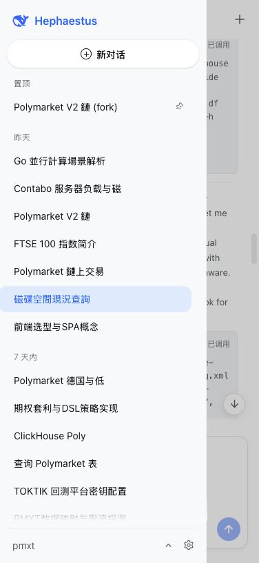
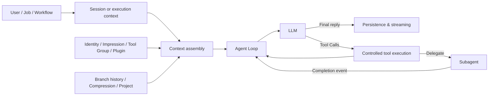
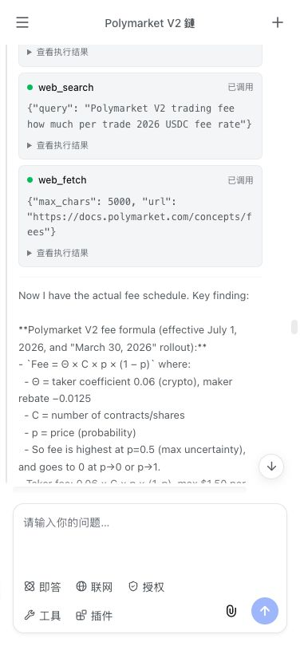

# Hephaestus

English | [简体中文](./README_zh-cn.md)

> A personal LLM harness built for long-term use: give the model an identity, context, tools, memory, and traceable actions.

Hephaestus is a single-user AI agent platform. Instead of treating a large language model as a one-shot Q&A endpoint, it provides a long-running host environment for agents: persistent sessions, branching history, composable personas and context, controlled tool calls, Project workspaces, natural-language workflows, and background subagents.

Think of it as your own AI console. Chat is only the entry point; the core is an agent runtime that keeps accumulating context, acts within explicit boundaries, and leaves a complete record of its work.



## Why Hephaestus

A model only does the reasoning. A usable agent also has to answer harder questions:

- Who is the model in this turn, and which long-term principles should it follow?
- Which conversation branch does it see, and how does older history stay usable within a limited context window?
- Which tools may it use, and who approves sensitive operations?
- How do results from tools, workflows, and parallel delegation flow back into the conversation without losing context?
- How is the trail of a run preserved when configuration changes, the service restarts, or a reply is interrupted?

Hephaestus folds these questions into one clear runtime model:



## Key features

### Composable agent recipes

Each **Concierge** is a reusable agent recipe, composed in order from:

- **Identity**: system prompt, injected messages, model preference, and generation parameters.
- **Impression**: long-term background, behavioral principles, character settings, or few-shot message sequences.
- **Tool Group**: built-in tools exposed to the model as capability groups.
- **Plugin**: platform extensions that run during the lifecycle of model calls and the tool loop.

A Session created from a Concierge owns its settings from then on. You can switch identities and toggle Impressions, Tool Groups, or Plugins without breaking history.

### A real agent tool loop

Every turn is driven by one Agent Runner: call the model, parse tool calls, execute tools, write results back into the model context, and loop until a final answer is produced. Tool calls get scope filtering, output limits, audit records, and confirmation for sensitive operations. This is not a thin function-calling passthrough.

### Long-term memory, not a single chat log

Each session stores the full message tree; the active branch is determined by `active_leaf_message_id`. Editing, regenerating, and continuing from an older message all create branches you can revisit instead of overwriting records. When context nears the model window, the platform compresses older history while keeping recent raw messages and the key information needed to continue.

All sessions and messages are full-text searchable: the web UI offers cross-session search, and the model can find and read old conversations itself through the `chat_history` tool group. Search needs no vector database; on PostgreSQL it is accelerated by a `pg_trgm` index, and SQLite works too.

### Steer while running; interruptions lose nothing

While the agent is running a multi-step tool sequence, you don't have to wait or stop the whole turn:

- **Steering**: use `/steer <text>` or the steering control in the UI to add an instruction, injected at the next tool-call boundary. `normal` mode lets the current tool finish; `aggressive` mode skips the pending tool calls so the model reads your new instruction first.
- **Interruption preservation**: on `/stop` or a dropped connection, visible content already generated and completed tool exchanges are saved; the reply is marked incomplete and can be continued later. If the active branch changed meanwhile, the result is kept as an accessible inactive branch.
- **Reliable shutdown**: cancellation cascades down subagent chains; if a run still ignores cancellation after a grace period, the platform force-terminates it so the session never stays stuck in `running`.

### Asks when it needs to

With the `ask_questions` tool group enabled, the model can ask one to five questions at once when key information is missing, each with two to five options and always allowing free-form input, instead of guessing. Sensitive tool calls go through a separate authorization flow, answerable from both the web UI and the QQ Channel.

### Configuration in the UI

The web app includes a configuration workbench for creating, duplicating, editing, and deleting Identities, Impressions, Tool Groups, Concierges, Workflows, and Jobs, with the same full validation used at startup applied before saving. While editing an Identity or Impression you can generate a sample AI reply on the spot to check the effect before saving. The UI supports Simplified Chinese and English, plus light, dark, and system themes.

### Projects are the agent's workspace

A Project groups sessions, uploaded files, and a working directory. Within controlled boundaries, the model can search history, process attachments, access Project files, search the web, or — once explicitly enabled — run local or remote shell commands.

### Workflows, Jobs, and Subagents

- **Workflow**: breaks repeatable work into sequential natural-language steps; each step is an independent, persisted agent tool loop.
- **Job**: triggers Workflows based on time, session activity, and past run state.
- **Subagent**: supports foreground `fork` or background `spawn` delegation; background results flow back to the parent session as durable events, and idle sessions automatically resume a turn to process them.



## Quick start

### Prerequisites

- macOS or Linux
- Go 1.26.9 or newer
- Node.js 22 or newer, with npm
- At least one model provider: the DeepSeek API, or an OpenAI-compatible local model server
- For the managed install: [PM2](https://pm2.keymetrics.io/) and `nc`

The guided installer below installs all of these automatically (it needs `sudo` on Linux).

Hephaestus depends on a fork of GoQQBot through a `replace` directive, so `go install` is not supported. Clone the repository and build from source.

### Guided install (recommended)

```sh
git clone https://github.com/Cyvadra/hephaestus.git
cd hephaestus
./scripts/install.sh
```

The installer installs anything missing — git, make, curl and nc through your package manager (Homebrew on macOS, which must already be installed), Go and Node.js from their official tarballs on Linux, and PM2 through npm, with mainland China mirrors as a fallback. It then asks for your settings (login, model provider, web fetch, optional search providers and QQ bot, optional proxy), infers location and timezone from the system timezone, generates `.env` with a random JWT secret and `600` permissions, then builds and starts both services under PM2 and optionally registers them to start at boot.

| Option | Effect |
| --- | --- |
| `--no-start` | Stop after writing `.env`. |
| `--yes` | Install missing dependencies without asking. |
| `--reconfigure` | Regenerate `.env` even if one exists; the old file is backed up. |

When it finishes, open `http://127.0.0.1:5173`.

### Manual setup

Build the server:

```sh
make build-server
```

Create `.env` in the repository root from the template:

```sh
cp .env.example .env
chmod 600 .env
```

At minimum, set authentication, the database, the environment location, and one model source:

```dotenv
HEPHAESTUS_AUTH_USERNAME=your-name
HEPHAESTUS_AUTH_PASSWORD=choose-a-strong-password
HEPHAESTUS_JWT_SECRET=at-least-32-random-bytes
HEPHAESTUS_DATABASE_URL=sqlite://./data/hephaestus.db

# Either DeepSeek or a local OpenAI-compatible server
HEPHAESTUS_DEEPSEEK_API_KEY=your-api-key
# HEPHAESTUS_LOCAL_MODEL_URL=http://127.0.0.1:11434/v1

# Firecrawl is the default web fetch provider; set to local to use headless Chrome instead
HEPHAESTUS_FIRECRAWL_API_KEY=your-firecrawl-key
# HEPHAESTUS_WEB_FETCH_PROVIDER=local

HEPHAESTUS_ENV_LOCATION=My Workspace
HEPHAESTUS_ENV_LATITUDE=39.9042
HEPHAESTUS_ENV_LONGITUDE=116.4074
HEPHAESTUS_ENV_TIMEZONE=Asia/Shanghai
```

A JWT secret can be generated with `openssl rand -hex 32`.

Start the API:

```sh
go run ./cmd/hephaestus
```

It listens on `http://127.0.0.1:9016` by default; Swagger API docs are at:

```text
http://127.0.0.1:9016/swagger/index.html
```

In another terminal, start the web UI:

```sh
cd frontend
npm install
npm run dev
```

Then open:

```text
http://127.0.0.1:5173
```

## First use

1. Create a Project and a Session.
2. Choose a Concierge, or use the default general assistant.
3. Start chatting; the model acts within the current Session's identity, context, Project, and tool boundaries.
4. Use slash commands to inspect or adjust the current runtime environment.

These local commands are not written to the chat history and are never sent to the model:

| Command | Purpose |
| --- | --- |
| `/help`, `/ping` | Show command help or check service connectivity. |
| `/status` | Show the current identity, Project, context estimate, and recent warnings. |
| `/list <kind>`, `/detail <kind> <id>` | Browse configuration, sessions, Projects, Workflows, and Jobs. |
| `/switch` | Switch Identity, Concierge, Project, or to another Session. |
| `/activate`, `/deactivate` | Toggle the current Session's Impressions, Tool Groups, or non-fixed Plugins. |
| `/clear [true\|false]` | Start a new session from the current Session's settings. |
| `/new [true\|false]` | Start a new session from the source Concierge's current settings. |
| `/stop` | Request that the current run stop. |
| `/steer [normal\|aggressive] <text>` | Add an instruction to a running task; `/steer cancel` withdraws one not yet delivered. |
| `/edit [n] <text>` | Edit the `n`-th most recent user message and resend it, keeping the original as a branch; `n` defaults to 1. |
| `/last [count]`, `/replay [count]` | Resend the latest assistant reply or the last few turns, handy for reviewing in external Channels. |
| `/interact approve\|deny` | Explicitly approve or deny a sensitive operation. |
| `/interact auto-approve` | Temporarily enable auto-approval for the current Session in this process; `cancel-auto-approve` turns it off. |

Items shown by `/list <kind>` can be referenced by ordinal (e.g. `1` or `#1`); `/switch session <ordinal|#session-id>` switches to another persistent Session.

## Runtime model

### Configuration layer and runtime layer

Identities, Impressions, Tool Groups, Concierges, Workflows, and Jobs in `config/` are readable, version-controllable baseline configuration. At startup these templates are synced to the database; later runtime edits are fully validated and applied atomically to new runs.

Configuration changes never silently alter a Workflow or Job that has already started. Each run captures its own definition, so execution records stay explainable and reviewable.

### Session context

Before every model call, the system assembles the effective context:

```text
Rendered Identity
+ Identity injected messages
+ Ordered Impressions
+ Plugin injections
+ Compression available on the current branch
+ Recent history on the current branch
+ Project and attachment context
+ This turn's user input
+ Currently allowed tool definitions
```

This is what separates Hephaestus from "stuffing the chat log back into the model": the identity, memory, and capabilities the model sees always come from explicit configuration and runtime state.

### Tools, web, and attachments

Built-in tool groups cover chat history search (`chat_history`), Project management (`project`), file delivery (`send_file` in `basic`), asking the user questions (`ask_questions`), web search and fetch (`web`), shell (`shell`), and subagent delegation (`subagent`). New Project directories come with an `AGENTS.md` skeleton for recording that workspace's conventions. `web_search` aggregates several search providers, with optional Brave, Tavily, SerpAPI, and SearXNG; `web_fetch` goes through Firecrawl by default and can fall back to a local headless browser.

A user message can carry up to five attachments. Allowed small text files go straight into the prompt; JPEG, PNG, GIF, and WebP can be sent to the current model as vision input; other files are still saved to the Project with a controlled reference.

Shell is off by default. When enabled, high-risk operations require confirmation; `/interact auto-approve` lasts only for the current server process and is cleared on restart.

## Built-in plugins

Plugins run during the lifecycle of model calls and the tool loop. Plugins listed in `HEPHAESTUS_FIXED_PLUGINS` are always on for every Session and cannot be disabled; the rest can be toggled per Concierge or Session.

| Name | Purpose |
| --- | --- |
| `environment` | Injects basic environment info such as time, location, and weather into the first message. |
| `metaphysics` | Injects Chinese almanac, Four Pillars, and Qimen Dunjia information into the first message. |
| `session_summary` | Automatically generates and periodically updates the session title and summary. |
| `storyline_status` | Appends the current storyline state after each assistant reply. |
| `traditional-cc` | Converts the first user message from Simplified to Traditional Chinese. |
| `options` | Suggests possible next user messages after a reply. |

## Configuration reference

The backend reads process environment variables plus an optional `.env` file in the working directory. "Required" below means required when the corresponding feature is enabled.

| Variable | Default | Description |
| --- | --- | --- |
| `HEPHAESTUS_AUTH_USERNAME` | required | Single-user login name. |
| `HEPHAESTUS_AUTH_PASSWORD` | required | Single-user login password; stored in plaintext in `.env` by design, so restrict file permissions. |
| `HEPHAESTUS_JWT_SECRET` | required | JWT signing secret of at least 32 bytes; do not reuse the login password. |
| `HEPHAESTUS_DATABASE_URL` | required | Sessions, history, configuration, and run data; `sqlite://./data/hephaestus.db` works locally. |
| `HEPHAESTUS_DEEPSEEK_API_KEY` | required without a local model | Enables DeepSeek and LLM-based web content condensing. |
| `HEPHAESTUS_LOCAL_MODEL_URL` | none | OpenAI-compatible local model server URL. |
| `HEPHAESTUS_LOCAL_MODEL_API_KEY` | none | Optional API key for the local model server. |
| `HEPHAESTUS_ANTHROPIC_URL` | none | Anthropic Messages API server URL without `/v1`, e.g. `https://api.anthropic.com`. |
| `HEPHAESTUS_ANTHROPIC_API_KEY` | none | API key for the Anthropic backend. |
| `HEPHAESTUS_ANTHROPIC_WORKSPACE` | none | Optional workspace ID, required for keys not scoped to one workspace. |
| `HEPHAESTUS_ANTHROPIC_MODELS` | none | Optional comma-separated model names for servers without a models endpoint. |
| `HEPHAESTUS_CONFIG_DIR` | `./config` | Default registry template directory. |
| `HEPHAESTUS_LISTEN_ADDR` | `127.0.0.1:9016` | API listen address. |
| `HEPHAESTUS_COOKIE_SECURE` | `false` | Set to `true` when a reverse proxy terminates HTTPS so the session cookie gets `Secure`. |
| `HEPHAESTUS_PROJECTS_ROOT` | `./data/projects` | Root path for Project directories; supports `~`. |
| `HEPHAESTUS_PROJECT_ACCESS_OVERRIDE` | `false` | Allow file tools to access paths outside the Project and system temp directories. |
| `HEPHAESTUS_SHELL_ENABLED` | `false` | Enable the shell tool. |
| `HEPHAESTUS_SHELL_BACKEND` | `local` | Shell target: `local` or `ssh`. |
| `HEPHAESTUS_SHELL_SSH_DESTINATION` | none | Required for SSH shell; an SSH config alias or `user@host`. |
| `HEPHAESTUS_SHELL_SSH_PROJECTS_ROOT` | none | Required for SSH shell; absolute POSIX path of the remote Project root. |
| `HEPHAESTUS_ENV_LOCATION` | required | Location name used in a new Session's first-turn context. |
| `HEPHAESTUS_ENV_LATITUDE` | required | Latitude, `-90` to `90`. |
| `HEPHAESTUS_ENV_LONGITUDE` | required | Longitude, `-180` to `180`. |
| `HEPHAESTUS_ENV_TIMEZONE` | required | IANA timezone, used for time, lunar calendar, and Four Pillars calculations. |
| `HEPHAESTUS_WEATHER_PROVIDERS` | `open_meteo,wttr,met_no` | Fallback order of weather services for first-turn environment context. |
| `HEPHAESTUS_FIXED_PLUGINS` | `environment,session_summary` | Plugins always enabled on every Session. |
| `HEPHAESTUS_PROXY_URL` | none | Used only by `make deploy`: outbound proxy injected into the PM2 processes; nothing is injected when empty. |
| `HEPHAESTUS_NO_PROXY` | `127.0.0.1,localhost` | Used only by `make deploy`: proxy exclusion list. |
| `HEPHAESTUS_WECOM_WEBHOOK_URL` | none | WeCom webhook that receives warning and error notifications. |
| `HEPHAESTUS_WEB_FETCH_PROVIDER` | `firecrawl` | Web fetch implementation: `firecrawl`, `local` or `deepseek`. DeepSeek is also the last fallback whenever `HEPHAESTUS_DEEPSEEK_API_KEY` is set. |
| `HEPHAESTUS_FIRECRAWL_API_KEY` | required with Firecrawl | Firecrawl API key. |
| `HEPHAESTUS_WEB_FETCH_CHROME_PATH` | auto-detected | Chrome or Chromium path for local fetching. |
| `HEPHAESTUS_WEB_FETCH_MAX_CHARS` | `16000` | Cap on captured page text before it is summarized or truncated. |
| `HEPHAESTUS_WEB_FETCH_SUMMARY_MAX_CHARS` | `4000` | Maximum length of LLM-generated page digests. |
| `HEPHAESTUS_WEB_SEARCH_BRAVE_API_KEYS` | none | Comma-separated Brave Search API keys. |
| `HEPHAESTUS_WEB_SEARCH_TAVILY_API_KEYS` | none | Comma-separated Tavily API keys. |
| `HEPHAESTUS_WEB_SEARCH_SERPAPI_API_KEYS` | none | Comma-separated SerpAPI API keys. |
| `HEPHAESTUS_WEB_SEARCH_SERPAPI_ENGINE` | `google_light` | SerpAPI engine identifier. |
| `HEPHAESTUS_WEB_SEARCH_SEARXNG_BASE_URL` | none | Optional SearXNG instance URL. |
| `HEPHAESTUS_WEB_SEARCH_SUMMARY_MAX_CHARS` | `4000` | Maximum length of LLM-generated search digests. |
| `HEPHAESTUS_QQ_APP_ID` | none | Optional QQ Bot AppID; must be set together with the AppSecret. |
| `HEPHAESTUS_QQ_APP_SECRET` | none | QQ Bot AppSecret. |
| `HEPHAESTUS_QQ_USER_OPENID` | none | OpenID of the one QQ user allowed into this deployment; see [QQ Channel](#qq-channel) if left empty. |
| `HEPHAESTUS_CHANNEL_IMAGE_TEXT_WAIT_SECONDS` | `30` | How long an image-only message waits for a following text message. |
| `HEPHAESTUS_UPLOAD_TEXT_EXTENSIONS` | `md,markdown,txt,csv,json,yaml,yml,toml,xml` | Text extensions that may be included directly in the prompt. |
| `HEPHAESTUS_UPLOAD_IMAGE_EXTENSIONS` | `jpg,jpeg,png,gif,webp` | Extensions sent directly as vision input after MIME validation. |
| `HEPHAESTUS_UPLOAD_INLINE_TEXT_MAX_BYTES` | `10240` | Size cap for a text file injected directly into the prompt. |
| `HEPHAESTUS_UPLOAD_EXCERPT_HEAD_BYTES` | `4096` | Head excerpt bytes for oversized text files; non-text files contribute only path and metadata. |
| `HEPHAESTUS_UPLOAD_EXCERPT_TAIL_BYTES` | `2048` | Tail excerpt bytes for oversized text files. |
| `HEPHAESTUS_UPLOAD_FILE_MAX_BYTES` | `52428800` | Maximum size of one attachment. |
| `HEPHAESTUS_UPLOAD_TOTAL_MAX_BYTES` | `262144000` | Maximum total attachment size per message. |
| `HEPHAESTUS_UPLOAD_MAX_FILES` | `5` | Maximum attachments per message. |

The per-file limit cannot exceed the per-message total.

### Runaway output guard

Models occasionally fall into a degenerate loop, repeating the same text without ever returning a `finish_reason`. `max_tokens` doesn't stop this in time: the stream keeps writing until the 30-minute run timeout. The guard inspects the stream byte by byte, aborts the request once output is judged degenerate, and trims the repeated segment from the message so it is neither persisted nor fed back as context next turn. The truncated message is saved as `incomplete`, keeping the clean prefix from before the degeneration began.

Three checks run in increasing order of cost on the content, the reasoning, and each tool call's arguments: single-byte runs, sliding-window compression ratio (which catches repeated phrases, not just repeated characters), and an absolute byte cap. The window-ratio default has generous headroom: the worst 4 KB window of real text in this repository compresses to 28–64%, while degenerate output is far lower (0.61% for a repeated character, 1.53% for a repeated phrase, 3.56% for a repeated sentence). The 3.9% default sits above all three and about 7× below real text, so character, phrase, and sentence loops are all caught.

| Variable | Default | Description |
| --- | --- | --- |
| `HEPHAESTUS_LLM_REPETITION_GUARD_DISABLED` | `false` | Set to `true` to disable the guard entirely. |
| `HEPHAESTUS_LLM_REPETITION_MAX_CHAR_RUN` | `1024` | A run of identical bytes this long is judged degenerate. |
| `HEPHAESTUS_LLM_REPETITION_WINDOW_BYTES` | `4096` | Size of the trailing window for the compression check. |
| `HEPHAESTUS_LLM_REPETITION_MIN_BYTES` | `4096` | Channels shorter than this are not checked, so short replies are never affected. |
| `HEPHAESTUS_LLM_REPETITION_RATIO_PERCENT` | `3.9` | A window compressing below this percentage of its size is judged degenerate; decimals allowed. |
| `HEPHAESTUS_LLM_MAX_CHANNEL_BYTES` | `8388608` | Absolute cap per channel, for non-repetitive runaway output. |
| `HEPHAESTUS_CHATRUN_MAX_EVENT_BYTES` | `16777216` | Cap on persisted streaming payload per run; exceeding it cancels the run. |

The last one is a backstop: every streaming delta writes a `chat_run_events` row, so even an output source that bypasses the guards above cannot grow without bound. Normally the LLM guard fires first.

`HEPHAESTUS_UPLOAD_OCR_IMAGE_MAX_BYTES`, `HEPHAESTUS_BAIDU_OCR_API_KEY`, and `HEPHAESTUS_BAIDU_OCR_SECRET_KEY` are deprecated and ignored. `HEPHAESTUS_POSTGRES_DSN` is a deprecated alias of `HEPHAESTUS_DATABASE_URL`; it still works but prints a notice at startup.

## Subagents

With the `subagent` Tool Group enabled on a Concierge, the model gets these controlled delegation tools:

- `spawn`: start an independent child Session in the background and return a run ID immediately.
- `fork`: seed an independent child Session from the current conversation and wait for the result.
- `await`: wait for direct background tasks that existed at call time; select tasks with `run_ids` and return early with `timeout_seconds` (unfinished tasks are marked `still_running`).
- `subagent_list`: list tasks it delegated (optionally only running ones).
- `subagent_status`: check a task's state, latest output while running, or result when done, without waiting (partial output is kept on failure or stop).
- `subagent_steer`: send a new instruction to a running task, delivered at the next tool boundary; `interrupt` skips its next tool call.
- `subagent_stop`: stop a running task, keeping partial output.

These tools only operate on tasks the caller delegated directly. Subagent permission requests are auto-approved by default; a single run is capped at 8 hours.

Background results don't live only in memory. Completion events are persisted first; if the parent Session is running, the result is injected at the next model boundary; if the Session is idle, the system automatically resumes a turn so the parent agent can digest it.

## QQ Channel

Set `HEPHAESTUS_QQ_APP_ID` and `HEPHAESTUS_QQ_APP_SECRET` to enable the QQ C2C Channel; both must be provided. With none of the QQ variables set, no external Channel starts.

`HEPHAESTUS_QQ_USER_OPENID` restricts access to a single user. Leave it empty on first deployment: the bot then replies to any sender with their own OpenID and processes nothing, so you can copy the value into the config and restart.

Each QQ conversation processes messages serially and is bound to a persistent Session; the first message creates a Session from the default Concierge. `/new`, `/clear`, and Session switching update the binding. External Channels wait for the complete reply rather than forwarding model deltas; attachments are copied into the Session's Project, and files delivered by the agent can be sent back to QQ.

Permission requests are sent as separate prompts, and the next QQ reply is taken as the decision. A reply containing `确认` or `yes`, or consisting solely of `y` or `1`, approves the request; unanswered requests are handled by the deployment's timeout policy.

## Remote SSH shell

With `HEPHAESTUS_SHELL_BACKEND=ssh`, the existing `shell` tool runs remotely with the same name and parameters. The service uses the system `ssh` command with `BatchMode=yes`; configure authentication, host keys, ports, and `ProxyJump` via `~/.ssh/config` or an SSH agent before starting.

For a Project named `default`, the local file workspace and the remote shell workspace are intentionally separate:

```text
Local:  <HEPHAESTUS_PROJECTS_ROOT>/default
Remote: <HEPHAESTUS_SHELL_SSH_PROJECTS_ROOT>/default
```

Create and prepare the remote directory before enabling this. The SSH shell does not sync local Project files, uploads, or `AGENTS.md`; file tools still access the local Project. A relative `working_directory` is relative to the remote Project, and absolute paths are remote absolute paths. By default only the current remote Project and `/tmp` are allowed; set `HEPHAESTUS_PROJECT_ACCESS_OVERRIDE=true` to allow other remote paths.

## Deployment

In production, the frontend listens on port `5173` on all interfaces; the API stays bound to `127.0.0.1:9016` and is reached through Vite's same-origin `/api` proxy. `./scripts/install.sh` sets all of this up on a fresh machine. To deploy by hand, prepare Go, Node.js, PM2, and the production environment:

```sh
cp .env.example .env
# edit .env, then
make deploy
```

`make deploy` builds the backend and frontend, creates or restarts `hephaestus-api` and `hephaestus-web` under PM2, saves the PM2 process list, and verifies that local ports `9016` and `5173` are reachable. Re-run it after every `.env` change.

The `.env` in the repository root is the authoritative source of production configuration. At startup its values override same-named variables left over from PM2 or the parent process, so stale model URLs or keys are never reused. `make deploy-build` only builds, for cases where no restart is needed.

After deploying, `curl -s 127.0.0.1:9016/healthz` confirms the API is alive and shows its build version.

Do not expose the HTTP listeners directly to the internet. Deploy behind a TLS-terminating reverse proxy that forwards `/api` to the frontend, and keep the backend port `9016` private. In that setup you must set `HEPHAESTUS_COOKIE_SECURE=true`, or session cookies won't carry the `Secure` attribute. The frontend uses SPA routing, so a production static host or reverse proxy must fall back to `index.html` for unknown non-`/api` routes.

For private remote access, use SSH forwarding:

```sh
ssh -N -L 5173:127.0.0.1:5173 user@server
```

Then open `http://127.0.0.1:5173`.

## Verification

```sh
make check   # go vet + golangci-lint + go test -race
make build
```

`make check` requires golangci-lint v1.64 or newer. `make test`, `make vet`, and `make lint` are also available individually. With `HEPHAESTUS_TEST_POSTGRES_DSN` set, `make test-integration` runs integration tests against a real Postgres.

Once running, `GET /healthz` returns the service status and build version without authentication; `./hephaestus --version` prints the same version.

## Design boundaries

- Hephaestus serves one trusted long-term user; it is not a multi-tenant collaboration platform.
- Login uses a challenge digest so the password is never sent in plaintext; after repeated failures a proof-of-work is required first. See [`SECURITY.md`](./SECURITY.md).
- A Project is a boundary for work context and file organization, not a multi-user security boundary.
- Chat history search does not depend on a vector database.
- Configuration, message branches, tool calls, and automated runs are preserved by preference, for review, debugging, and picking work back up.
- Files, shell, web fetching, and external Channels can all reach external systems; enable them with care for your deployment environment.

## Documentation

- [`docs/release/Hephaestus.md`](./docs/release/Hephaestus.md): full description of core concepts and the runtime model.
- [`SECURITY.md`](./SECURITY.md): threat model, authentication design, and deployment requirements.
- [`CONTRIBUTING.md`](./CONTRIBUTING.md): development environment, check commands, and configuration file conventions.
- [`CHANGELOG.md`](./CHANGELOG.md): release history.

## Acknowledgements

The initial `pkg/channels` implementation is adapted from PicoClaw's [`pkg/channels`](https://github.com/sipeed/picoclaw/tree/main/pkg/channels), under the MIT License.

Parts of the agent harness implementation reference DeepSeek's [`deepseek-harness`](https://github.com/deepseek-ai/deepseek-harness), under the MIT License.

The QQ Channel uses a fork of [GoQQBot](https://github.com/ProgramCX/GoQQBot), under the MIT License.

Full third-party copyright and license notices are in [`THIRD_PARTY_NOTICES.md`](./THIRD_PARTY_NOTICES.md). Hephaestus itself is released under the GNU GPL v3.
